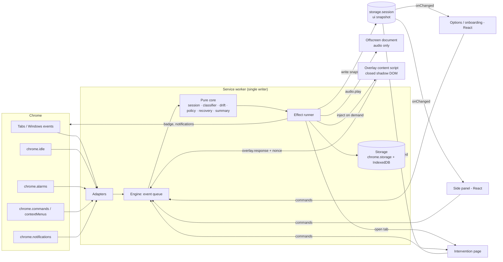
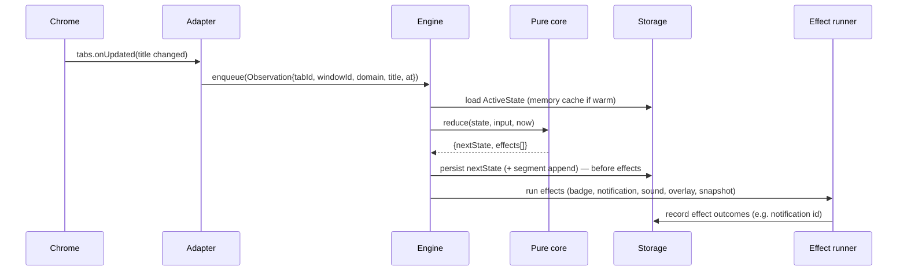
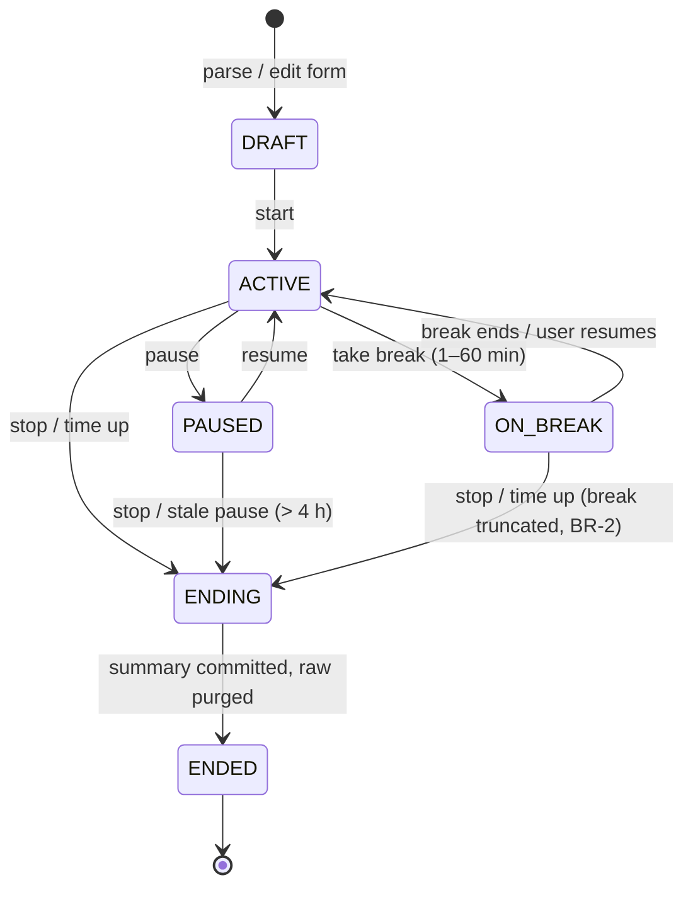
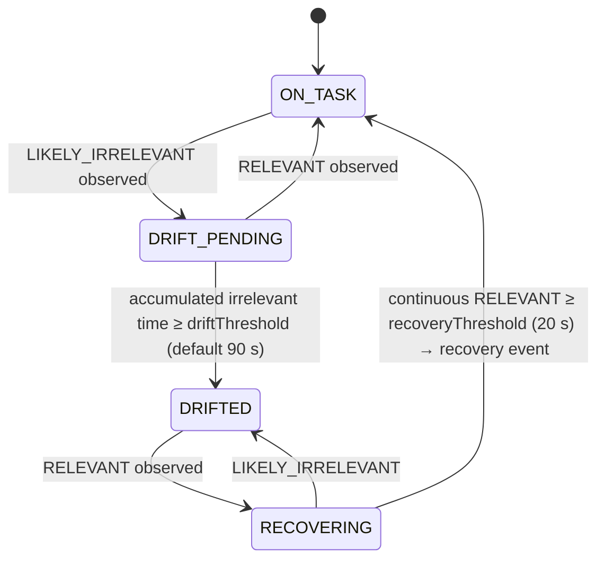

# Focus Buddy — Architecture (V1)

| Field | Value |
|---|---|
| Status | **v1.1 (Day 07, D-021).** v1.0 approved Day 03 after two independent reviews. v1.1 adds the §5.1.1 transition table and the Day 07 engine scope. Day 05 added the §13 results |
| Owner | Principal Architect (Claude Opus 5.5) |
| Inputs | [PRD](PRD.md) v1.0, [FEASIBILITY](FEASIBILITY.md) SD-1 to SD-11 |
| Companion docs | [API_CONTRACTS](API_CONTRACTS.md) · [DATA_MODEL](DATA_MODEL.md) · [SECURITY](SECURITY.md) · [ADRs](DECISIONS/) |

---

## 1. Architectural principles

1. **Functional core, imperative shell.** All decisions are made by pure functions with no Chrome APIs and an injected clock: parsing, classification, drift detection, intervention policy, recovery text and summaries. Thin adapters translate Chrome events into plain inputs and execute plain outputs ("effects"). The core is fully unit-testable without a browser.
2. **The service worker is the single writer.** Only the service worker (SW) mutates session state or persisted data. UI pages send *commands* and read a *snapshot*. This avoids write races between contexts.
3. **Assume the SW can die between any two events.** Every handler loads the state it needs, computes, persists, then acts. No correctness depends on in-memory variables surviving. Memory is only a cache.
4. **Event-driven, with one bounded tick.** No polling when no session is active. During an ACTIVE session a single 30 s alarm re-evaluates time-based thresholds (FEASIBILITY §3 shows the alarm wakes a stopped SW).
5. **Collect less, keep less.** Data is minimised *before* it reaches storage (exclusions, incognito, URL reduction). Raw activity lives only for the life of a session (D-010).
6. **No network by default.** A strict extension-page CSP (`default-src 'none'`; only `'self'` sources) plus a lint ban on network APIs in all code. The SW's own `fetch` isn't assumed to be covered by the CSP (unverified), so the lint and the AC-10 test are the guarantee. Turning on AI is a separate, approved change (ADR-0005).
8. **Tab titles are never persisted.** Titles are classified in memory and then dropped. Only host, class and timings reach storage (security review finding 12, D-015).
7. **Simple before clever.** No framework in the SW, no state library in the UI, no ML. Each abstraction must earn its place by enabling a test or removing duplication.

---

## 2. Runtime contexts



| Context | Responsibility | Lifetime | Never does |
|---|---|---|---|
| **Service worker** | All logic, all writes, all Chrome event listeners | Ephemeral (≤ 30 s idle) | Hold critical state only in memory; render UI |
| **Side panel** | Session controls, status, recovery prompts, summary | While open (per window) | Write storage directly; read raw activity except via "view what's recorded" |
| **Options / onboarding page** | First run, permission explanations, preferences, privacy controls, data deletion | While open | Same as panel |
| **Intervention page** | Full action set when the panel is closed (SD-3); opened as a normal extension tab | While open | Same as panel |
| **Offscreen document** | Play alert tones (AUDIO_PLAYBACK) with one shared AudioContext (SD-11) | Created on demand; Chrome closes it after 30 s of silence | Anything except audio; never receives user data |
| **Overlay content script** | Strict-mode overlay only; injected per intervention via `scripting.executeScript` | One intervention | Read page content; persist anything; trust page events |

No content script is declared in the manifest. Nothing runs on web pages unless an overlay is being shown.

---

## 3. Source layout (proposal; scaffolding on Day 05)

```
src/
  core/              # pure TypeScript, no chrome.* imports (lint-enforced)
    clock.ts         # Clock interface + system/fake implementations
    session/         # state machine, time accounting
    parser/          # natural-language task parser, known-site dictionary
    classifier/      # relevance pipeline, rules, topic vocabulary
    drift/           # hysteresis evaluator (episodes)
    policy/          # intervention ladder, cooldowns, caps, quiet hours, mute
    recovery/        # recovery message builder
    summary/         # summary + aggregates
    messages/        # message-bank strings + banned-phrase list
    types.ts         # shared domain types
  shell/             # imperative shell (service worker)
    engine.ts        # serialised event queue; load → reduce → persist → effects
    effects.ts       # effect runner
    adapters/        # tabs, windows, idle, alarms, notifications, badge,
                     # commands, contextMenus, permissions, offscreen, overlay
    messaging/       # router + sender validation + schemas
    storage/         # repositories over chrome.storage and IndexedDB, migrations
    sw.ts            # entry: registers listeners synchronously at top level
  ui/
    sidepanel/  options/  intervention/   # React apps
    shared/          # components, snapshot hook, command client
  offscreen/         # audio player
  content/overlay.ts # injected overlay (no framework)
tests/
  unit/  integration/  e2e/                # e2e = puppeteer-core harness (SD-7)
```

An ESLint `no-restricted-imports` rule forbids `chrome`, `shell/*` and `ui/*` imports from `core/*`.

---

## 4. The engine: how one event is processed



Rules:
- **Serialised queue.** Inputs are processed one at a time (a promise-chain mutex). This avoids the lost-write race the Day 2 spike had to work around. The queue lives in memory and is lost if the SW stops. That's acceptable because of three guarantees: (1) startup reconciliation is always the first item enqueued; (2) migrations finish before any other handler runs; (3) no input relies on an earlier, unprocessed input. Every input carries everything it needs, and state is re-derived from Chrome on start.
- **Persist before effects, at-most-once for intrusive channels.** Before running any effect for an intervention, the engine persists `pending = {interventionId, attemptedAt}`. The notification id *is* the `interventionId`, so re-creating it replaces rather than duplicates. On restart, an intervention that has `attemptedAt` set is **never replayed** for sound or the overlay. Only the badge and snapshot are re-asserted. This prevents duplicates (NFR-3, AC-02) at the cost of possibly losing one sound if the SW dies mid-effect. That's the safer failure.
- **Listeners are registered synchronously at the top level of `sw.ts`.** MV3 only delivers events to listeners registered during the first turn of the event loop.
- **Startup reconciliation** (on every SW start and on `runtime.onStartup`):
  1. Migrations (idempotent per backend).
  2. Re-set `idle.setDetectionInterval` and `storage.local.setAccessLevel` (DATA_MODEL §1). Re-create alarms from state (SD-1).
  3. Finish any `ENDING` session (DATA_MODEL §4).
  4. Purge raw-tier rows of any session that is not active. This step doesn't depend on the schema, so it also runs in safe mode.
  5. Prune aggregates older than `retentionDays` (AC-28).
  6. If an active session exists: close the open segment at `lastSeenAt` and count the gap as *away* (the browser was closed). End the session if it expired while closed (J10). Re-derive the current context with one `tabs.query`, deduplicated against the persisted `current.obsKey`.
  7. Republish the snapshot.

### Inputs (to the core)
`Observation` (focused tab context changed), `IdleChanged`, `FocusChanged` (browser focused/unfocused), `Tick`, `Command` (from UI), `InterventionResponse`, `PermissionChanged`, `Startup`.

### Effects (from the core)
`AppendSegment`, `CloseSegment`, `SetBadge`, `SetActionTitle`, `UpdateActionMenu`, `ShowNotification`, `ClearNotification`, `PlaySound`, `ShowOverlay`, `RemoveOverlay`, `OpenInterventionPage`, `TryOpenSidePanel`, `PublishSnapshot`, `ScheduleAlarm`, `ClearAlarm`, `BuildSummaryAndPurgeRaw`.
State persistence isn't an effect: the engine always does it before running effects.

---

## 5. Core modules

### 5.1 Session state machine (FR-S1 to S7, BR-1 to BR-3)

- Time accounting uses persisted timestamps: `elapsed = now − startedAt − Σ(paused/break intervals)`. Remaining = planned + extensions − elapsed. A PAUSED session's clock is stopped, so it can't hit "time up". A pause longer than 4 h ends the session with reason `stale_pause`.
- `ENDING` is persisted *first*, with `endReason` and `endedAt`, so a crash during summary/purge is finished by reconciliation and never resumes the session.
- Idle, locked and browser-unfocused are an **orthogonal attention state** (`ACTIVE_INPUT | IDLE | LOCKED | BROWSER_UNFOCUSED`). They don't change session time (BR-1), but they suspend drift evidence and block interventions (§5.5).
- **Auto-pause for absence (anti-covert-monitoring, security finding 9; BR-1 amended):** if the screen is LOCKED for > 10 min, or IDLE for > 30 min, the session auto-pauses. On return the panel asks "Continue your session?", and monitoring resumes only after the user confirms.
- Pause, break and resume reset drift to ON_TASK and close any open episode.
- Invalid transitions return an error result. Nothing is thrown, and state is unchanged.

### 5.1.1 Transition table (Day 07; the reducer implements exactly this)

`now` is the input's timestamp, supplied by the shell from an injected `Clock`; the reducer never reads a clock.

**Time:**
- `elapsedMs = now − startedAt − Σ closed pauses − (open pause ? now − open.from : 0)`.
- `totalMs = (plannedMin + extensionsMin) × 60 000`.
- `remainingMs = max(0, totalMs − elapsedMs)`.
- `endsAt = now + remainingMs` while ACTIVE / ON_BREAK; for PAUSED it's the frozen value `pausedAt + remaining at pause`.

| From | Input | Guard | To | Effects / notes |
|---|---|---|---|---|
| none | `session.start {draft}` | draft valid (DATA_MODEL validators); no active session | ACTIVE | new id; `startedAt = now`; `attention = ACTIVE_INPUT`, `attentionSince = now`; alarms `fb.sessionEnd` (when = endsAt), `fb.tick` (30 s); start notification (`start.*`, generic if private); badge `ON`; action title; snapshot |
| any active | `session.start` | — | unchanged | error `invalid_state {activeSessionId}` (AC-29) |
| ACTIVE | `session.pause` | — | PAUSED | open pause `{from: now, kind: "pause"}`; clear `fb.tick`, `fb.sessionEnd`; set `fb.stalePause` (now + 4 h); drift → ON_TASK; badge `II` |
| PAUSED | `session.resume` | not `awaitingContinue` | ACTIVE | close pause; re-set `fb.sessionEnd`, `fb.tick`; clear `fb.stalePause`; badge `ON` |
| PAUSED | `session.resume` | `awaitingContinue` | unchanged | error `invalid_state` (use `session.continue`) |
| PAUSED | `session.continue` | `awaitingContinue` | ACTIVE | as resume, plus clears `awaitingContinue` and `awaySince`; clears the continue notification |
| ACTIVE | `break.start {minutes 1–60}` | — | ON_BREAK | open pause `{kind: "break"}`; `breakEndsAt = min(now + minutes, the moment the session would end)` (BR-2; while on break the session clock is stopped, so the cap is `now + remainingMs`); alarms `fb.breakEnd`, clear `fb.tick`; badge `BRK` |
| ON_BREAK | `break.end` / alarm `fb.breakEnd` | — | ACTIVE (alarm path: stays ON_BREAK and shows the break-over prompt, see next row) | user path: close pause, resume as above |
| ON_BREAK | alarm `fb.breakEnd` | — | ON_BREAK | break-over notification (`break.over.*`); set `fb.breakPrompt` (now + 5 min) once (BR-3). The session clock stays stopped until the user acts. **Decision:** an unanswered break never consumes session time |
| ON_BREAK | alarm `fb.breakPrompt` | prompt not yet repeated | ON_BREAK | repeat the notification once; then nothing more (BR-3) |
| ON_BREAK | `break.extend {1–15}` | — | ON_BREAK | `breakEndsAt += minutes` (capped as above); re-arm `fb.breakEnd`; reset the BR-3 repeat |
| ACTIVE / PAUSED / ON_BREAK | `session.extend {5–120}` | total ≤ 480 | unchanged | `extensionsMin += minutes`; re-arm `fb.sessionEnd` if ACTIVE; error `invalid_argument` over the cap |
| ACTIVE / PAUSED / ON_BREAK | `session.updateNote` | lengths valid | unchanged | — |
| ACTIVE | alarm `fb.sessionEnd` or any input with `remainingMs = 0` | — | ENDING `time_up` | see ENDING |
| ACTIVE / PAUSED / ON_BREAK | `session.stop` | — | ENDING `user_stop` | see ENDING |
| PAUSED | alarm `fb.stalePause` or any input with an open pause ≥ 4 h | — | ENDING `stale_pause` | — |
| ACTIVE | `IdleChanged {state, at}` | — | ACTIVE | `attention`, `attentionSince = at` (the event's own time) |
| ACTIVE | `Tick` / `IdleChanged` | attention LOCKED ≥ 10 min, or IDLE ≥ 30 min (from `attentionSince`) | PAUSED | open pause `{from: attentionSince, kind: "auto_absent"}` (the absence itself isn't counted as session time); `awaitingContinue = true`; `awaySince = attentionSince`; badge `II`; no notification yet |
| PAUSED · awaitingContinue | `IdleChanged {active}` | — | PAUSED | show the "Continue your session?" notification once (`continue.*`); snapshot |
| ENDING | (immediately, same input) | — | none | persist ENDING **first**; then effect `BuildSummaryAndPurgeRaw` (SessionRecord from the session's times + whatever segments exist; activity aggregates are zero until Day 09+); clear every `fb.*` alarm and the session's notifications; badge none; snapshot `session: null`, `lastSummaryId` |

**Reconciliation (Day 07 scope of §4):** steps 1–5 and 7, plus step 6 without the `tabs.query` part (Day 09):
- The gap from `lastSeenAt` to now is closed as AWAY.
- An ACTIVE session whose `endsAt ≤ now` ends `expired_while_closed`; a PAUSED one over 4 h ends `stale_pause`.
- Alarms are re-created from state.
- A `{corrupt}` `session.active` is ended as `stale_pause` with no summary (DATA_MODEL §8).

**Decisions taken after implementation (Day 07, D-022):**
- **Browser closed (gap from `lastSeenAt` to Startup).**
  - It counts as session time (wall clock, BR-1), so a session that ran out while Chrome was closed ends `expired_while_closed` (J10).
  - The gap goes into `ActiveState.awayMs` (summary `awayMin`) and is not recorded as a pause.
  - If the session survives and the gap is ≥ 10 min, it auto-pauses at Startup (`awaitingContinue`, `awaySince = lastSeenAt`), the same anti-covert rule as a long lock (D-016).
- **Idle or locked auto-pause.** The pause starts at `attentionSince`, so that absence is excluded from session time (D-021). The two kinds of absence differ on purpose: the user wasn't at the machine with a session they could see, and the session only paused once the rule fired.
- **Ending checks.** Time-up and stale-pause are checked before every input. An input that arrives after the end ends the session and replies `ok`.
- **Stale break.** An ON_BREAK longer than 4 h also ends with `stale_pause`.
- **`session.extend` over the 480-min cap** clamps to the cap and replies `ok {cappedAt}`; the UI shows `extend.capped`.
- **`session.resume` while ON_BREAK** returns `invalid_state`; `break.end` is the command.
- **Resuming resets attention.** Resume, continue and break end set `attention = ACTIVE_INPUT` at `now`.
- **`notified.*`** is per occurrence: break prompts reset per break or extension, and the continue prompt resets per auto-pause. `start` is never reset.
- **Ticks.** A tick that changes nothing refreshes `lastSeenAt` only when it is ≥ 60 s old (§7 amended), so the browser-closed gap stays accurate.
- **Summary purge.** Summary building deletes segments only. Interventions are aggregate data and are kept with their SessionRecord (DATA_MODEL §1).
- **Alarm persistence.** `persistAcrossSessions: true` is passed when the Chrome major version is ≥ 150 (SD-1).

**Decisions from the Day 07 review (D-023):**
- **ENDING is retried on every input**, not only at Startup. A failed summary write can't leave the user stuck; `session.stop` on ENDING replies `ok`.
- **Idle events are back-dated.** Chrome reports `idle` only after `idleThresholdSec`, so the input's time is `now − idleThresholdSec`. The 30-minute rule then counts from the last real input.
- **No double counting.** When Startup finds attention IDLE or LOCKED, the browser-closed gap isn't added to `awayMs`; the auto-pause from `attentionSince` already covers it. Invariant (property-tested): active + away + break + pause time never exceeds the wall clock.
- **Start notification after a crash (AC-32).** At Startup, an ACTIVE session younger than 60 s whose start notification isn't showing gets it once more.
- **Leftover notifications.** At Startup with no session, every `fb.*` notification is cleared.
- **Boot failure.** If storage can't open, commands reply `storage_error`, a `safe_mode` or `storage_error` notice is published, and initialisation is retried on the next input.
- **Thresholds are inclusive (≥)** for 10 min, 30 min and 4 h.
- **Boot marker.** `diag.boot {seq, at}` in `storage.session` is written on every SW evaluation (no user data). The restart e2e uses it to prove a real restart.

**Effect idempotence:**
- Notification ids are deterministic (`fb.start.<sessionId>`, `fb.continue.<sessionId>`, `fb.break.<sessionId>`).
- Alarms are named, so re-creating one replaces it.
- A restart never re-shows a notification whose `attemptedAt` is persisted (NFR-3, AC-02).

### 5.2 Activity observation (FR-M1, M2, M5, M7, M9)
The tabs adapter produces at most one `Observation` per *context change* of the focused window's active tab. It also re-runs on `tabs.onReplaced` (prerender) for the new tab id. The pipeline works on the **raw URL and title in memory**. Only the step-7 output can ever be stored.
1. Drop if no ACTIVE session (FR-M4: early return before any work).
2. Incognito: drop if incognito monitoring isn't enabled. If it is enabled, mark the observation `ephemeral` (FR-M5). Ephemeral observations are classified in memory only. They produce a segment with **no host** (time accounting only), never update `lastRelevant` or overrides, and the snapshot shows "Private window".
3. Normalise: lowercase the host, strip `www.`, convert punycode to Unicode for matching, percent-decode the path, detect IP literals.
4. **Exclusion check on the raw data** (§5.3 step 1), including the search query and the title. Excluded → `{excluded: true}` with no host, path or title (FR-M6, AC-09).
5. Extension-internal and browser-internal pages (`chrome-extension://<own id>/*`, `chrome://*`, new tab) → `internal` (neutral). Opening our own intervention page never counts as drift.
6. Placeholder detection: empty title, `about:blank`, a title equal to the URL without its scheme, or a bare site name → `placeholder: true` (SD-5).
7. **Reduce for storage:** keep `host` only. Titles and paths are never stored (D-015). A `pathHint` (e.g. `youtube.com/watch`, `/search`) is used in memory by the classifier and discarded.
8. Dedup: `obsKey = hash(tabId, host, normalisedTitle)`, compared with the persisted `current.obsKey`. Same key → drop. A per-tab rate limit (≥ 1 s) guards against title floods (SECURITY T11).

### 5.3 Relevance classifier (FR-C1 to C7)
A pure function: `classify(obs, sessionCtx, caches) → {class, confidence, reason}`.

| Step | Rule | Result |
|---|---|---|
| 1 | Sensitive exclusion, by **category**: banking/payment, auth/account (`/login`, `/signin`, `/oauth`, `/settings/security`, `/settings/credentials`, `/password`, `/2fa`, `/checkout`, `/billing`), email/webmail, private messaging/chat, health/medical, legal, dating/adult, job search, government ID services, plus user exclusions and search pages whose query hits the sensitive-term list. Normalised host/path matching (step 3 above) with fixture tests for ccTLD, IDN, IP and subdomain variants | EXCLUDED (neutral) |
| 2 | Internal page (own extension, `chrome://`, new tab) | EXCLUDED (reason `internal`, neutral) |
| 3 | Placeholder title | UNCERTAIN (`placeholder`) |
| 4 | User override ("This is relevant") matching host + title **substring** (no regex). Exclusion always wins over an override; the UI says so | RELEVANT |
| 5 | Allowed, *not* mixed-use host | RELEVANT |
| 6 | Title/keyword match against the topic vocabulary (any host) | RELEVANT |
| 7 | Known-distraction rules: entertainment patterns ("top 10", "highlights", "goals", "trailer", "reaction", …) or a distraction-host list | LIKELY_IRRELEVANT |
| 8 | Allowed **mixed-use** host (YouTube, Reddit, Wikipedia, …) with no vocabulary or distraction match | UNCERTAIN |
| 9 | Non-allowed host, no vocabulary match | LIKELY_IRRELEVANT (lower confidence) |
| 10 | Optional AI: only for UNCERTAIN from step 8, within caps, off by default in V1. Its results are cached in memory per session; there's no classification cache in V1, because rules take < 5 ms | as returned, else UNCERTAIN |

**Search and results pages** (known search engines, `/search`, `/results`) are classified from the title in memory. Like every page, only host + class is stored (D-015).

The **topic vocabulary** (FR-C4) is built once at session start: the task subject and user keywords, tokenised and normalised (case, punctuation, simple stemming), plus an optional bundled topic pack keyed by subject (Day 11 decides the format, OQ-3).

### 5.4 Drift evaluator (FR-C6, AC-23)
Hysteresis per session. Times come from observations and ticks.

- **Freeze, don't reset.** `drift.accumulatedMs` counts only LIKELY_IRRELEVANT time. UNCERTAIN, EXCLUDED, placeholder titles and suspended attention (idle, locked, unfocused) *pause* the accumulator. Only RELEVANT resets it. Without this, a YouTube placeholder title or a 2 s app switch would restart the 90 s clock, and Scenario C/D would never fire.
- UNCERTAIN alone never *starts* DRIFT_PENDING (D-004). Idle is never distraction (D-006).
- Each DRIFTED entry opens a **drift episode** (`episodeId`). Interventions belong to episodes.
- Pause, break, resume and session end close the episode and return to ON_TASK. A session ending mid-intervention emits `ClearNotification` and `RemoveOverlay`. Late responses get `not_found`.

### 5.5 Intervention policy (FR-I1 to I11, BR-4, BR-6, BR-7)
A pure function: `decide(episode, prefs, history, now) → Intervention | none`.
- **Ladder levels:** L1 nudge (badge + panel + notification-if-allowed), L2 notification (`requireInteraction`) + sound, L3 overlay (only if enabled and the host permission is held; otherwise L2 + intervention page).
- **Mode → ladder:** Gentle = L1 only, at most one repeat per episode after the cooldown (BR-4). Adaptive = start L1, +1 level per ignored intervention, −1 after "relevant" feedback or a quick recovery (P1). Strict = L2 first, then L3.
- **Gates, in order** (any failure → no intervention):
  1. Session ACTIVE (not PAUSED, ON_BREAK or ENDING).
  2. `attention == ACTIVE_INPUT` (AC-19).
  3. **Global per-mode cooldown** since `policy.lastDeliveredAt`. This covers new episodes too (AC-06). Defaults: Gentle 15 min, Adaptive 10 min, Strict 5 min (minimums 10 / 5 / 3).
  4. Per-episode repeat limit (Gentle: 1 repeat).
  5. Hourly cap (default 4, hard max 6).
  6. Per-session cap (default 12).
- **Channel filters** (applied after the gates; they reduce channels, never cancel the intervention):
  - Quiet hours and mute (BR-6, BR-7) remove sound and overlay. The visual nudge still happens.
  - Notifications denied → badge + panel + page (FR-I10).
  - "Private notifications" preference → generic notification text, with no task label.
- "Ignored" means no response and no recovery within 2 min of delivery. It's evaluated at the next event or tick, so up to 30 s late.

### 5.6 Recovery & summary
- Recovery text order: next-step note → the last RELEVANT tab's **live** title, read with `tabs.get(lastRelevant.tabId)` at that moment and never stored → objective (FR-R1). The template comes from the reviewed message bank (FR-I8).
- Recovery copy includes a short "Break's over?" prompt at break end. It repeats at most once, after 5 min, and never escalates (BR-3). Break timing uses the one-shot alarms `fb.breakEnd` and `fb.breakPrompt`.
- The summary is built during ENDING from segments and interventions. After it's committed, the raw tier is purged (`BuildSummaryAndPurgeRaw`). The user can then tick "objective done" (`summary.setObjectiveDone`).

---

## 6. UI state propagation (ADR-0003)

- The SW publishes a compact **UiSnapshot** (≤ 4 KB) to `chrome.storage.session` after every state change. UI pages read it on load and subscribe with `storage.onChanged`.
- Why: it works while the SW is asleep, needs no long-lived ports (which would keep the SW alive), and every open page and window sees the same state.
- `storage.session` is cleared on browser restart. The SW republishes during startup reconciliation.
- The snapshot is published **only when its content changes**, not on every tick. It carries `endsAt` and `breakEndsAt`, and pages compute countdowns themselves (frozen while PAUSED).
- The snapshot never contains titles, except the recovery suggestion the user is meant to see (live title, in memory). The current-context label is a host, "Private site", "Private window" or "Browser page". "View what's recorded" uses an explicit request/response command.

---

## 7. Timing model (ADR-0006)

| Mechanism | Use |
|---|---|
| `fb.tick` alarm, 30 s period | Only while a session is ACTIVE (not PAUSED or ON_BREAK). Re-evaluates drift/recovery thresholds, "ignored" detection and quiet hours. Cleared otherwise. A tick that changes nothing writes nothing, except a `lastSeenAt` refresh when it is ≥ 60 s old (D-022) |
| `fb.sessionEnd` alarm, `when = endsAt` | Ends the session (re-scheduled on extend/pause/resume) |
| `fb.breakEnd`, `fb.breakPrompt` one-shot alarms | Break end, and the single "break over?" repeat (BR-3) |
| `fb.stalePause` one-shot alarm | Ends a pause longer than 4 h |

NFR-1 ("SW idle between events") is relaxed *during ACTIVE sessions*: the 30 s tick may keep the SW resident for most of a session (uncertain). The cost is one cheap handler run per 30 s. There's no tick outside ACTIVE sessions.
| Event-time evaluation | Every observation re-evaluates thresholds immediately |
| Persisted timestamps | Source of truth; alarms are only wake-up calls |

Accepted tolerance: threshold onset up to +30 s late (D-011). Alarm names are namespaced and re-created idempotently on startup. `persistAcrossSessions` is passed only on Chrome ≥ 150 (SD-1).

---

## 8. Permissions (justified in SECURITY.md §3)

Required: `tabs`, `idle`, `alarms`, `storage`, `sidePanel`, `offscreen`, `notifications`, `scripting`, `contextMenus`.
Optional (runtime, gesture): `http://*/*` and `https://*/*` host permissions (narrower than `<all_urls>`, which adds `file://`), only for the Strict overlay (SD-2, amended).
Toolbar action context menu (`contextMenus`): Open Focus Buddy, Pause / Resume, Add 15 minutes, Mute all and pause ▸, End session… (opens the inline confirm; never ends directly) (FR-S6, FR-I11, AC-29; UX_GUIDELINES v1.0 §2.1, D-018).
Not requested: `history`, `webNavigation`, `webRequest`, `cookies`, `activeTab`, `unlimitedStorage`, `externally_connectable`.

---

## 9. Performance budgets (NFR-1, NFR-2, NFR-12)

| Budget | Target | How measured (from Day 9) |
|---|---|---|
| Rules classification | < 5 ms p95 per observation | Vitest micro-benchmark on fixtures |
| Event handling (excluding storage I/O) | < 20 ms p95 | Engine timing in a debug build |
| Storage writes | ≤ 1 segment write per context change; tick writes only if state changed | Counter in integration tests |
| Work with no active session | 0 alarms, listeners return in < 1 ms | Integration test + Chrome task manager check |
| SW bundle | < 150 KB minified | Build report |
| Overlay content script | < 15 KB | Build report |
| Raw activity per session | ≤ 5,000 segments. At the cap, the last segment is extended instead of new ones being added | Unit test |
| Segment boundaries | A new segment on context change **and** on attention change (idle/locked/unfocused), so idle time is reported separately (AC-19) | Unit test |
| 8 h simulated session | No unbounded growth; remaining time ±1 s | Day 21 soak test (fake clock) |

---

## 10. Error handling

- Every adapter call is wrapped. A Chrome API failure (missing permission, closed tab, offscreen already exists) becomes a typed result. The core decides the fallback (FR-I10, BR-8, AC-24, AC-27).
- Storage failure: in-memory state continues for that wake, the snapshot shows "couldn't save" once, and the next wake retries. Corrupted or invalid records are replaced with defaults and the user is told (FR-H1, AC-15).
- UI pages treat an unanswered command (SW starting) with one automatic retry, then a calm message.
- There's no remote error reporting. A local diagnostic log (last 200 entries) is viewable on the options page. It stores **error codes only**, never `chrome.runtime.lastError.message`, because Chrome error strings embed URLs. Production builds strip `console.*` calls that could print observations. No uncaught error may carry a title, because those show in chrome://extensions → Errors.

---

## 11. Extension points (designed, not built in V1)

- `AiClassifier` interface: `classify(minimalInput) → Promise<Result>`. V1 ships `MockAiClassifier` and the disabled default (ADR-0005).
- `DeviceLink` interface for the Android QR join (SD-8): one-way payload builder only, if the Day 22 gate passes.

---

## 12. Testing strategy (critical path)

| Layer | Tooling (final choice Day 05) | Covers |
|---|---|---|
| Unit (core) | Vitest, fake clock | Parser, classifier fixtures (≥ 40), drift hysteresis, policy gates, session time math, summary |
| Integration (shell) | Vitest + in-memory chrome.* fakes | Engine ordering, persist-before-effects, dedup, restart reconciliation, migrations |
| E2E | puppeteer-core + Chrome (SD-7) | AC-02 (SW stop via `ServiceWorker.stopAllWorkers`), AC-10 network silence (request interception), AC-17/18/24, overlay controls |
| Manual | Checklists | Native notifications, audio audibility, shortcut, lock screen, screen reader |

---

## 13. Platform facts (verified Day 05)

Probe: `tests/e2e/platform/` (test-only extension + local HTTP server that records whether a request really left the browser). Evidence: `tests/e2e/platform/results-day05.json`. **All results are Chrome 157.0.8103.51, headless, macOS.** Chrome 120 (the minimum) was not tested, because the owner hasn't approved the Chrome for Testing download. Every "yes" below is therefore "yes on 157" until Day 05's Chrome 120 item is closed.

| # | Question | Day 05 result | Design consequence |
|---|---|---|---|
| V1 | Does `storage.local.setAccessLevel({accessLevel: "TRUSTED_CONTEXTS"})` work? | **Yes.** A content script read `storage.local` before the call and got "Access to storage is not allowed from this context" after it. **It does not survive a browser restart**: after relaunching the same profile the content script could read again (it does survive a SW stop, per the reviewer). | **Re-apply at top level on every SW evaluation**, not only in `onInstalled`/`onStartup` (Day 05 review F1, fixed in `src/shell/sw.ts`). A hardened probe showed that a content script running *before* the SW's first evaluation after a restart can still read; once the SW has run it's blocked. Focus Buddy declares no content scripts, and its only one (the overlay) is injected by the SW, so **the SW must await `harden()` before any `executeScript`** (SECURITY R7) |
| V2 | What is `sender.url` for messages sent from the SW to the offscreen document? | `chrome-extension://<id>/sw.js` exactly (= `getURL("sw.js")`); no `tab`, `frameId` or `documentId`; `id` = own id | The offscreen check can be exact: `sender.id === runtime.id && sender.url === getURL("sw.js") && !sender.tab` |
| V3 | Does the `extension_pages` CSP cover the SW's `fetch`? | **Yes.** The SW fetch to a local server was blocked and never reached it. A control extension, identical except `connect-src *`, did reach the server (200), so the block is the CSP | CSP is a real layer for the SW. Lint and the AC-10 test stay, because the CSP doesn't cover content scripts or WebRTC |
| V4 | Does `connect-src 'self'` allow `fetch` of bundled files? | **Yes**, from both a page and the SW (200). An external fetch from a page was blocked and didn't reach the server | Topic packs may be fetched or imported. ADR-0007's lint still bans `fetch`, so packs are imported as modules unless a vetted helper is added |
| V5 | Does `idle.setDetectionInterval` persist across SW restarts? | **Not observable** (no getter) | Already re-set on every SW start |
| V6 | Is `storage.session` cleared on extension reload? | **Yes**, for a reload done by loading the same unpacked path again; the reviewer confirmed the SW really restarted. `chrome.runtime.reload()` couldn't be tested (in this harness it left the probe disabled), and a Web Store update wasn't tested | Snapshot is republished on start (already in the design) |
| V7 | Does `WINDOW_ID_NONE` fire briefly when the side panel or a notification takes focus? | **Not tested** (needs headed Chrome and real focus changes). Owner manual check M20 | Debounce BROWSER_UNFOCUSED by 2 s until verified |
| V8 | Can the overlay use a top-layer `<dialog>` from an isolated-world script? | **Yes.** `showModal()` from a closed shadow root: `:modal` true; the hit-test lands on the host; a page button can't take focus; a max-z-index page element can't cover it. Headless; focus tested with programmatic `focus()` | Overlay = `showModal()` dialog (UX F5); fallback L2 |
| UX-3 | Chrome's install warnings for the real manifest | `["Read your browsing history", "Display notifications"]` from `management.getPermissionWarningsByManifest` (required permissions only; the optional host prompt wasn't captured) | Onboarding wording confirmed exactly |
| UX-5 | Page inert while the overlay is modal | Yes (see V8) | — |
| UX-6 | Toolbar colours vs badge fills | **Not tested** (headless has no toolbar). Owner manual check M21 | Badge meaning carried by text (UX §2.1) |
