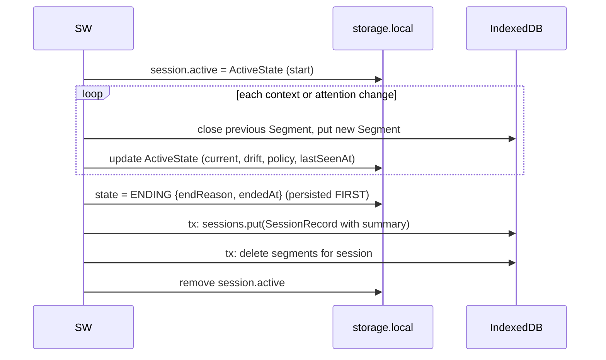

# Data model and persistence

| Field | Value |
|---|---|
| Status | **v1.0, approved Day 03** after two independent reviews (architecture, security). All findings applied |
| Decision | Hybrid storage (ADR-0002): `chrome.storage.local` for small, hot state; **IndexedDB** for append-heavy and history data; `chrome.storage.session` for the UI snapshot and short-lived secrets |
| Core rule | **Tab titles and URL paths are never persisted** (D-015). Storage holds hosts, classes and timings only |

## 1. Store map

| Store | Backend | Key | Tier | Retention |
|---|---|---|---|---|
| `prefs` | storage.local | `prefs` | settings | Until changed / reset |
| `overrides` | storage.local | `overrides.global` | settings (may hold short title substrings, shown in "View what's recorded") | Until the user removes them |
| `active` | storage.local | `session.active` | **raw** (session life) | Deleted when the session ends |
| `ui.snapshot` | storage.session | `ui.snapshot` | derived | Browser session |
| `overlay.pending` | storage.session | `overlay.pending` | secret (nonce) | ≤ 2 min |
| `segments` | IndexedDB `fb` | `[sessionId, seq]` | **raw** (host only, never titles) | Deleted when the summary is committed |
| `interventions` | IndexedDB `fb` | `[sessionId, id]` | aggregate (no hosts, no titles) | With its session |
| `sessions` | IndexedDB `fb` | `id` | aggregate | `prefs.retentionDays` (default 30, 0–90; 0 = keep nothing) |
| `diag` | storage.local | `diag.log` | diagnostic (error codes only) | Last 200 entries |
| `meta` | storage.local | `meta` | system | Permanent (`schemaVersion`, install time) |

**Access level:** at every SW start the SW calls `chrome.storage.local.setAccessLevel({accessLevel: "TRUSTED_CONTEXTS"})`. Without it, content scripts can read `storage.local` by default. Support on Chrome 120 is unverified (ARCH §13 V1). `storage.session` already defaults to trusted contexts. Even without the access-level call, nothing in `storage.local` is a title, a URL or a nonce.

**Why the split:** `chrome.storage.local` rewrites a whole value on every `set`. That's fine for state under 10 KB, but appending to a growing activity array would cost O(n) per write. IndexedDB handles appends, range scans and bulk deletes cheaply, and content scripts can't read the extension's IndexedDB. A remote DB is not justified.

**Dropped in review:** the IndexedDB classification cache. Rules take < 5 ms, so a cache adds nothing until a real AI provider exists, and AI results are cached in memory only (ARCH §5.3).

## 2. Records

```ts
// ---- settings tier ----
type Preferences = {
  schemaVersion: 1;
  defaultMode: "gentle" | "adaptive" | "strict";        // default "gentle"
  driftThresholdSec: number;        // 60–600, default 90
  recoveryThresholdSec: number;     // 10–120, default 20
  idleThresholdSec: number;         // 15–1800, default 300
  cooldownMin: { gentle: number; adaptive: number; strict: number }; // defaults 15/10/5, minimums 10/5/3
  maxPerHour: number;               // 1–6, default 4
  maxPerSession: number;            // 1–30, default 12
  sound: { enabled: boolean; tone: "chime" | "soft" | "bell"; volume: number /*0–1*/ };
  notificationsEnabled: boolean;    // default true
  privateNotifications: boolean;    // default false; true = generic text, no task label (lock screen / screen share)
  overlay: { enabled: boolean; countdownSec: 5 | 6 | 7 | 8 | 9 | 10; showTaskLabel: boolean }; // default false, 5, false
  quietHours: null | { start: "HH:MM"; end: "HH:MM" };   // device local time, may cross midnight
  incognitoMonitoring: boolean;     // default false
  userExclusions: string[];         // hosts, ≤ 200
  retentionDays: number;            // 0–90, default 30
  ai: { enabled: false; provider: "none" | "mock" };     // V1: no real provider
  onboardingDone: boolean;
};

type Override = { host: string; titleSubstring?: string /* ≤ 60, plain substring */; createdAt: number };

// ---- raw tier (session life only; storage.local) ----
type ActiveState = {
  schemaVersion: 1;
  session: SessionConfig & {
    id: string;
    state: "ACTIVE" | "PAUSED" | "ON_BREAK" | "ENDING";
    startedAt: number;              // single name for the start time (createdAt removed)
    plannedMin: number; extensionsMin: number;
    pauses: Array<{ from: number; to?: number; kind: "pause" | "break" | "auto_absent" }>;
    breakEndsAt?: number;
    ending?: { endReason: EndReason; endedAt: number };   // set first when ending
    awaitingContinue?: boolean;     // auto-paused for absence; needs user confirmation
  };
  lastSeenAt: number;               // updated on every write; used to close segments after a browser close
  attention: "ACTIVE_INPUT" | "IDLE" | "LOCKED" | "BROWSER_UNFOCUSED";
  current?: { segmentSeq: number; tabId: number; obsKey: string; class: RelevanceClass; since: number };
  drift: { phase: "ON_TASK" | "DRIFT_PENDING" | "DRIFTED" | "RECOVERING"; since: number; accumulatedMs: number; episodeId?: string };
  lastRelevant?: { tabId: number; host: string; at: number };   // live title read via tabs.get when needed
  policy: {
    level: 0 | 1 | 2 | 3;
    lastDeliveredAt?: number;       // global cooldown (AC-06)
    deliveredAt: number[];          // last 60 min, for the hourly cap
    sessionCount: number;
    repeatsByEpisode: Record<string, number>;
    mutedUntil?: number;
  };
  pending?: { interventionId: string; episodeId: string; level: 1 | 2 | 3; createdAt: number; attemptedAt?: number };
  sessionOverrides: Override[];
  segSeq: number;
};

type EndReason = "time_up" | "user_stop" | "expired_while_closed" | "stale_pause" | "deleted_all";

type SessionConfig = {
  taskLabel: string;            // ≤ 120
  objective: string;            // ≤ 300
  nextStep?: string;            // ≤ 500
  allowedHosts: string[];       // ≤ 50, normalised (lowercase, no www.)
  keywords: string[];           // ≤ 40
  mode: "gentle" | "adaptive" | "strict";
  // The original natural-language sentence is NOT stored (minimisation).
};

type Segment = {                // IndexedDB "segments" (raw tier)
  sessionId: string; seq: number;
  start: number; end?: number;
  host?: string;                // absent if EXCLUDED, internal or ephemeral (incognito)
  class: RelevanceClass; reason: ReasonCode;
  attention: ActiveState["attention"] | "AWAY";   // AWAY = browser was closed
  // NO title, NO path, NO URL — ever.
};

// ---- aggregate tier (kept for retentionDays) ----
type InterventionRecord = {
  sessionId: string; id: string; episodeId: string;
  level: 1 | 2 | 3; createdAt: number;
  deliveredVia: Array<"badge" | "panel" | "notification" | "sound" | "overlay" | "page">;
  response?: "back" | "relevant" | "break" | "mute" | "stop" | "continue" | "dismissed" | "ignored";
  respondedAt?: number;
  // no hosts, no titles
};

type SessionRecord = {
  id: string; startedAt: number; endedAt: number; endReason: EndReason;
  taskLabel: string; objective: string; mode: SessionConfig["mode"];
  plannedMin: number; actualMin: number;
  summary: {
    focusedMin: number; uncertainMin: number; driftMin: number; idleMin: number;
    awayMin: number; breakMin: number; excludedMin: number;
    driftEpisodes: number; recoveries: number;
    interventions: number; responses: Record<string, number>;
    relevantHosts: Array<{ host: string; minutes: number }>; // ≤ 10; RELEVANT hosts only
    otherMinutes: number;            // all non-relevant time, no host names kept
    objectiveDone?: boolean;
  };
};

type RelevanceClass = "RELEVANT" | "UNCERTAIN" | "LIKELY_IRRELEVANT" | "EXCLUDED";
type ReasonCode = "excluded" | "internal" | "placeholder" | "override" | "allowed_host" | "keyword"
                | "distraction_rule" | "mixed_use_no_match" | "not_allowed_no_match" | "ai" | "ephemeral";
```

`topHosts` from v0.1 was replaced by `relevantHosts` + `otherMinutes`, so the history tier keeps no record of which distracting sites were visited (security finding 13). When the user adds an exclusion, any matching `relevantHosts` entries are removed from history too.

## 3. Invariants (each has a test)

1. No record in any store contains a tab title or URL path. The only exception is the user's own `Override.titleSubstring` (AC-09, D-015).
2. EXCLUDED, internal and ephemeral (incognito) segments have no `host`. Incognito observations never update `lastRelevant`, `current.obsKey`, overrides or the snapshot label (AC-21).
3. When no session is active, `segments` is empty and `session.active` doesn't exist (AC-28).
4. `InterventionRecord` never contains a host or title.
5. At most one `session.active` exists.
6. ≤ 5,000 segments per session. At the cap, the last segment is extended instead of new ones being added.

## 4. Lifecycle



Crash safety: reconciliation finds `ENDING` and completes the remaining steps idempotently. An existing summary isn't rebuilt. Raw rows are deleted if present. `session.active` is removed. A session never resumes from `ENDING`.

## 5. Migrations

- `meta.schemaVersion` (storage.local) and the IndexedDB `version` are migrated **independently and idempotently**. Each migration checks the backend's current shape before acting, so a crash between the two leaves nothing half-applied.
- Each migration is a pure function `(old) → new` with a fixture test. IndexedDB store changes happen in `onupgradeneeded`.
- **Safe mode** (a migration fails): monitoring is disabled, the panel shows a notice, aggregates are kept, and the user can delete everything. The **raw-tier purge still runs**, because it doesn't depend on the schema (it deletes whole stores when no session is active). Raw data therefore never outlives a session, even in safe mode. Export is P2, so there's no export path in V1.
- Unknown or invalid preference fields → defaults for those fields only, plus a `prefs_reset` notice (AC-15).

## 6. Deletion (FR-H4, AC-12)

`data.deleteAll`, steps in order, each attempted even if an earlier one fails:
1. Set the session to ENDING with reason `deleted_all`. No summary is saved.
2. Clear all alarms, notifications (by id), the badge, the action title and action menu state.
3. Remove any overlay. Close the offscreen document.
4. Close the SW's IndexedDB connection and drop the in-memory cache, then `indexedDB.deleteDatabase("fb")`, handling `onblocked` (retry after closing connections).
5. `storage.local.clear()`, then re-write `prefs` if the user chose to keep preferences.
6. `storage.session.clear()`, then republish an empty snapshot.
7. Offer to revoke the optional host permission (a button; `permissions.remove` needs a user gesture on the page).

The result lists any step that failed. Note for users: notifications already delivered may remain in the operating system's notification history, which the extension can't clear (unverified).

## 7. Deferred: device association (Android)

Not stored in V1. If the Day 22 gate passes, the QR payload is computed on demand: `{v, sessionId (random), issuedAt, durationSec, mode, label?}`, with no stored device record (FEASIBILITY §5, Option A).
